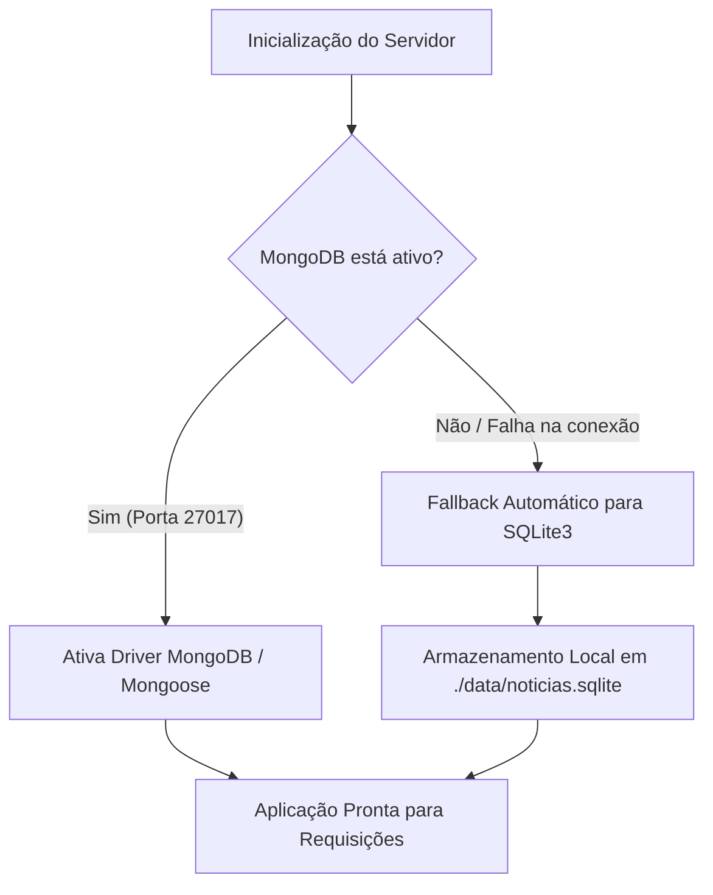

<div align="center">

# 📰 FocoNews • Portal de Notícias & Atualidades

<p align="center">
  <strong>Plataforma moderna de jornalismo digital desenvolvida em Node.js, com arquitetura de banco de dados híbrida (SQLite + MongoDB), armazenamento inteligente de imagens, autenticação segura e design editorial de alto contraste.</strong>
</p>

[](https://nodejs.org/)
[](https://expressjs.com/)
[](https://www.sqlite.org/)
[](https://www.mongodb.com/)
[](https://handlebarsjs.com/)
[](https://getbootstrap.com/)
[](LICENSE)

</div>

---

## 📌 Sumário

- [Sobre o Projeto](#-sobre-o-projeto)
- [Principais Funcionalidades](#-principais-funcionalidades)
- [Identidade Visual & Experiência de Leitura](#-identidade-visual--experiência-de-leitura)
- [Arquitetura Híbrida & Diferenciais](#-arquitetura-híbrida--diferenciais)
  - [Banco de Dados: SQLite Automático + MongoDB](#1-banco-de-dados-sqlite-automático--mongodb)
  - [Armazenamento de Imagens: Local Gratuito + Amazon S3](#2-armazenamento-de-imagens-local-gratuito--amazon-s3)
  - [Segurança & Proteção de Dados](#3-segurança--proteção-de-dados)
- [Tecnologias Utilizadas](#-tecnologias-utilizadas)
- [Pré-requisitos](#-pré-requisitos)
- [Como Executar o Projeto](#-como-executar-o-projeto)
- [Variáveis de Ambiente (`.env`)](#-variáveis-de-ambiente-env)
- [Estrutura de Diretórios](#-estrutura-de-diretórios)
- [Painel Administrativo & Demonstração](#-painel-administrativo--demonstração)
- [Licença](#-licença)

---

## 📖 Sobre o Projeto

O **FocoNews** nasceu como um projeto de aprendizado e foi completamente revitalizado e modernizado para se tornar uma aplicação web robusta, segura e pronta para produção. 

O objetivo do portal é permitir que:
- Leitores possam criar contas com segurança, comentar nas reportagens, curtir publicações, controlar o tamanho do texto e compartilhar matérias em suas redes sociais;
- Redatores e Administradores contem com um painel completo para gerenciar categorias, publicar matérias com editor de texto rico (*TinyMCE* local), upload de fotos de capa e monitorar métricas de audiência em tempo real.

---

## ✨ Principais Funcionalidades

### 👥 Para Leitores & Comunidade
- **Cadastro & Autenticação Segura:** Criação de conta com senha criptografada (*bcrypt*), login persistido via sessão (*Passport.js*) e recuperação de senha por token criptográfico expirável.
- **Sistema de Curtidas em Tempo Real:** Botão interativo para curtir/descurtir matérias sem recarregar a página (comunicação assíncrona via AJAX/Fetch API).
- **Métricas de Engajamento:** Contador automático de visualizações por postagem (`views`) e total de curtidas (`likes`).
- **Comentários Interativos:** Seção de comentários em cada notícia com avatar do leitor, data e opção de exclusão pelo próprio autor ou pelo Administrador.
- **Compartilhamento Social com 1 Clique:** Botões diretos para WhatsApp, X (antigo Twitter), Facebook, LinkedIn e botão de "Copiar Link" com feedback instantâneo.
- **Ferramentas de Acessibilidade:**
  - Ajuste dinâmico de tamanho de fonte (`A-` e `A+`) no corpo da matéria;
  - Cálculo automático de tempo estimado de leitura (ex: *3 min de leitura*);
  - Barra de progresso de leitura no topo da página.
- **Perfil do Usuário ("Minha Conta"):**
  - Histórico de matérias curtidas pelo leitor;
  - Lista de comentários publicados;
  - Edição do nome de exibição e upload de foto de perfil.

### 🛠️ Para Administradores (Painel `/admin`)
- **Dashboard com Métricas Reais:** Estatísticas consolidadas de total de matérias, visualizações somadas, curtidas, comentários, editorias e usuários cadastrados.
- **Gerenciamento de Matérias:** Criação, edição, exclusão e destaque no carrossel de capa.
- **Gerenciador de Editorias/Categorias:** Criação e edição com geração automática de *slug* em tempo real.
- **Gerenciamento de Usuários:** Listagem de leitores, atribuição de privilégios de Administrador e remoção de contas.
- **Editor Rico TinyMCE Local:** Integrado sem necessidade de chaves de API pagas ou bloqueios de terceiros.

---

## 🎨 Identidade Visual & Experiência de Leitura

O design do portal foi construído em torno de uma identidade visual jornalística de alto contraste:
- **Amarelo Editorial Solar (`#FFB800`):** Utilizado de forma precisa em selos de categorias, botões de ação primária, barras de progresso, rankings e detalhes de destaque;
- **Grafite Profundo (`#111315` / `#1C1F24`):** Presente no cabeçalho, rodapé e nos cards do ranking *Top 5 Em Alta*, garantindo sofisticação e conforto visual;
- **Tipografia Escaneável:** Hierarquia bem definida com títulos em negrito, subtítulos destacados e cards modernos com transições suaves no *hover*.

---

## 🧱 Arquitetura Híbrida & Diferenciais

### 1. Banco de Dados: SQLite Automático + MongoDB
Esqueça a dor de cabeça de configurar bancos de dados externos apenas para testar o projeto!



- **Zero Configuração Inicial:** Se você não tiver o MongoDB instalado na máquina, a aplicação detecta e ativa automaticamente o **SQLite3 local** (`data/noticias.sqlite`), criando todas as tabelas e relacionamentos sem qualquer intervenção manual;
- **Transparência Total:** A camada de modelos ([models/index.js](models/index.js)) fornece uma interface unificada (`find`, `findOne`, `findById`, `save`, `populate`, `sort`, `deleteMany`), funcionando de maneira idêntica em ambos os bancos.

### 2. Armazenamento de Imagens: Local Gratuito + Amazon S3
O upload de imagens (capas de notícias e avatares de perfis) conta com um módulo centralizado ([config/storage.js](config/storage.js)):
- **Modo Local Padrão (`STORAGE_TYPE=local`):** Gratuito e imediato, salvando os arquivos em `public/uploads/` com resolução automática e imagens de fallback caso o arquivo não exista;
- **Estrutura Secundária S3 (`STORAGE_TYPE=s3`):** Totalmente refatorada com `async/await`. Caso deseje utilizar o Amazon S3 em produção, basta preencher as credenciais no `.env` e alterar a variável para `s3`.

### 3. Segurança & Proteção de Dados
- **Variáveis de Ambiente:** Chaves sensíveis, segredos de sessão e credenciais protegidas via [`.env`](.env) e ignoradas no Git pelo [`.gitignore`](.gitignore);
- **Prevenção de Injeção & ReDoS:** O endpoint de busca textual sanitiza e escapa expressões regulares antes de consultar o banco;
- **Upload Seguro:** Validação de formato (*MIME Types* exclusivamente para imagens: PNG, JPG, WEBP, GIF), limite de tamanho (5MB) e proteção contra *Path Traversal*;
- **Recuperação de Senha Criptografada:** Utiliza tokens criptográficos aleatórios de alta entropia (`crypto.randomBytes`) com expiração de 1 hora, impedindo alterações não autorizadas;
- **Cookies de Sessão Blindados:** Cookies com atributos `httpOnly`, `sameSite: 'lax'` e ocultação do cabeçalho `X-Powered-By`.

---

## 💻 Tecnologias Utilizadas

| Camada | Ferramenta / Biblioteca |
|---|---|
| **Runtime & Servidor** | [Node.js](https://nodejs.org/) (v18+) e [Express.js](https://expressjs.com/) |
| **Bancos de Dados** | [SQLite3](https://www.sqlite.org/) (Local) e [MongoDB](https://www.mongodb.com/) via [Mongoose](https://mongoosejs.com/) |
| **Templates & Views** | [Express-Handlebars](https://handlebarsjs.com/) com helpers customizados |
| **Estilização & UI** | [Bootstrap 5](https://getbootstrap.com/) + CSS3 Editorial Customizado |
| **Autenticação & Sessões** | [Passport.js](http://www.passportjs.org/), `passport-local`, `bcryptjs`, `express-session`, `connect-flash` |
| **Upload & Armazenamento** | [Multer](https://github.com/expressjs/multer) e [AWS SDK](https://aws.amazon.com/sdk-for-node-js/) |
| **E-mails & Notificações** | [Nodemailer](https://nodemailer.com/) com suporte a SMTP, SendGrid e modo simulação local |
| **Editor de Texto Rico** | [TinyMCE](https://www.tiny.cloud/) (distribuído e servido localmente) |

---

## 📋 Pré-requisitos

Para rodar o projeto, você precisa apenas do:
- **[Node.js](https://nodejs.org/)** instalado (versão 18.x ou superior recomendada);
- **npm** (geralmente instalado junto com o Node.js).
*(O MongoDB é opcional, pois o SQLite assume automaticamente caso o MongoDB não esteja rodando).*

---

## 🚀 Como Executar o Projeto

1. **Clone este repositório:**
   ```bash
   git clone https://github.com/seu-usuario/noticias.git
   cd noticias
   ```

2. **Instale as dependências:**
   ```bash
   npm install
   ```

3. **Configure as variáveis de ambiente:**
   Copie o arquivo de exemplo para criar o seu `.env`:
   ```bash
   cp .env.example .env
   ```
   *(As configurações padrão já vêm prontas para rodar localmente com SQLite e armazenamento local)*.

4. **Inicie o servidor:**
   ```bash
   npm start
   ```

5. **Acesse no seu navegador:**
   ```text
   http://localhost:8081
   ```

> 💡 **Primeiro Acesso de Administrador:** Ao iniciar pela primeira vez e criar uma conta na tela de **Registro** (`/users/registro`), o sistema **automaticamente define esse primeiro usuário como Administrador** do portal!

---

## ⚙️ Variáveis de Ambiente (`.env`)

O arquivo [`.env.example`](.env.example) contém a documentação de todas as variáveis suportadas:

```env
# Servidor
PORT=8081
NODE_ENV=development
BASE_URL=http://localhost:8081

# Banco de Dados ('auto', 'sqlite' ou 'mongodb')
DB_CLIENT=auto
SQLITE_PATH=./data/noticias.sqlite
MONGO_URI=mongodb://127.0.0.1:27017/noticias

# Sessão
SESSION_SECRET=sua_chave_secreta_super_segura

# Armazenamento de Imagens ('local' ou 's3')
STORAGE_TYPE=local

# Amazon S3 (Opcional - preencha apenas se STORAGE_TYPE for 's3')
AWS_ACCESS_KEY_ID=
AWS_SECRET_ACCESS_KEY=
AWS_REGION=sa-east-1
AWS_BUCKET_NAME=

# E-mail (Opcional - SendGrid ou SMTP)
SENDGRID_API_KEY=
EMAIL_FROM=no-reply@noticias.local
SMTP_HOST=
SMTP_PORT=587
SMTP_USER=
SMTP_PASS=
```

---

## 📂 Estrutura de Diretórios

```plaintext
noticias/
├── config/                  # Módulos de configuração da aplicação
│   ├── auth.js              # Estratégia de autenticação local (Passport)
│   ├── db.js                # Inicializador híbrido e seletor de banco
│   ├── sqlite.js            # Engine SQLite3 com suporte aos métodos CRUD
│   └── storage.js           # Gerenciador de uploads (Local + Amazon S3)
├── helper/                  # Middlewares de permissão e autorização
│   ├── admin.js             # Validação de privilégios de Administrador
│   ├── register.js          # Validação de usuário autenticado
│   └── user.js              # Validação de confirmação de conta
├── models/                  # Schemas do Mongoose e Fachadas de Modelos
│   ├── index.js             # Proxies dinâmicos que roteiam para SQLite ou MongoDB
│   ├── Categoria.js         # Modelo de Editorias/Categorias
│   ├── Comentario.js        # Modelo de Comentários
│   ├── Postagem.js          # Modelo de Matérias, Curtidas e Visualizações
│   └── User.js              # Modelo de Usuários, Permissões e Tokens
├── public/                  # Arquivos estáticos servidos pelo Express
│   ├── css/                 # Arquivos Bootstrap
│   ├── img/                 # Imagens base e logotipos
│   ├── js/                  # Scripts cliente (Bootstrap bundle)
│   ├── style/               # Estilo visual editorial customizado (style.css)
│   └── uploads/             # Diretório padrão para armazenamento local de imagens
├── routes/                  # Rotas modulares da aplicação
│   ├── admin.js             # Rotas do painel administrativo
│   └── users.js             # Rotas de login, registro, perfil e senha
├── views/                   # Templates Handlebars
│   ├── admin/               # Telas do painel administrativo
│   ├── error/               # Páginas de erro (404 customizada)
│   ├── layouts/             # Layout principal (main.handlebars)
│   ├── partials/            # Componentes reutilizáveis (navbar, footer, carrossel, etc.)
│   ├── usuario/             # Telas de login, registro e recuperação de senha
│   ├── busca.handlebars     # Página de resultados de pesquisa
│   ├── categoria.handlebars # Página de matérias por editoria
│   ├── index.handlebars     # Página inicial (feed + ranking mais lidas)
│   └── postagem.handlebars  # Página completa da reportagem
├── .env.example             # Modelo das variáveis de ambiente
├── .gitignore               # Arquivos e pastas ignorados no versionamento
├── app.js                   # Ponto de entrada da aplicação
└── package.json             # Dependências e scripts do projeto
```

---

## 🎯 Painel Administrativo & Demonstração

Para acessar o painel administrativo:
1. Certifique-se de estar logado em uma conta com privilégios de Administrador (`Admin: true`);
2. Clique no menu **ADMIN** na barra superior ou acesse diretamente:
   ```text
   http://localhost:8081/admin
   ```
3. No painel, você terá acesso ao resumo das métricas, atalhos rápidos e poderá criar matérias definindo se elas devem ou não aparecer no carrossel de destaque da capa.

---

## 📄 Licença

Este projeto é distribuído sob a licença **ISC**. Consulte o arquivo [package.json](package.json) para mais detalhes.

---

<div align="center">
  <sub>Desenvolvido com dedicação e aprimorado com arquitetura limpa, segurança e design editorial.</sub>
</div>
